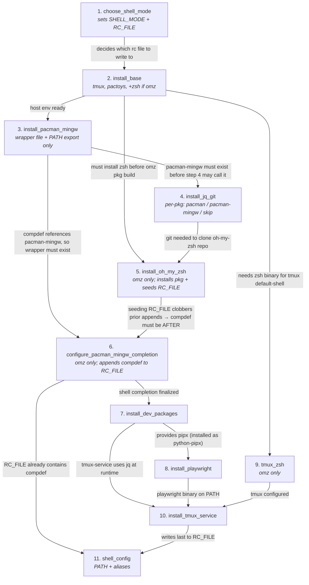

# objective

## jinja2 template hierarchy

build a jinja2 template hierarchy with following corpus:

```markdown
now read @todo.md and implement the project. always keep the git workspace clean, commit immediately as long as you edit files. if you understand, commit staged changes first, then the unstaged.

# .env spec

.env should NEVER be exposed to the public. if some tool depended on that, use a different name and ensure it is ignored first. 

create a `.env.example` with all sensitive credentials erased. 

# TDD spec

use TDD to push the project (unit test first, red as WIP commits and green as implementation commits). use git log to check how to do if any. once you have done, use git push to push to remote.

# msys2 specific clarifications

 `uv`, `git`, `ollama`, `npm`, `bun` and `podman-compose` are  at `C:\Users\fufu\Downloads\msys64\clang64\bin`, feel free to use. use C:\Users\fufu\Downloads\msys64\msys2_shell.cmd to mimic msys2 environments (you need escalation to do that, so keep these call minimal). `bun` is installed by `npm` provided by `mingw-w64-nodejs` package which combability might be not as good as `npm`. if they are not available, just escalate to install them. 

## ssh issues on windows msys2

ssh may be blocked not because of the sandbox but the msys2 ssh binary depends on the msys2 dll which is often outside the sandbox. change to windows native ssh client to do git push, and check the ssh key matches under msys2 environment and copy keys if they don't match (use msys2 home directory as the source of truth)

## deepseek harness sandbox issues on windows and linux

deepseek will actively block `curl.exe` to not accidentally visit internet. on Linux the sandbox is even stricter: `/dev` is complete virtual and jailed.

but python code accessing the internet is not restricted on windows and Linux. 

you need to escalate (or prompt me to switch to dangerous full access mode, but i prefer escalate) to bypass the sandbox. 

remember i have NO TIME to play with your trial and error game for multiple escalations. if you have to access to internet, write reusable python scripts instead of the fancy `curl` call. 

# github api token

the api token is here: `{{your fine-grained GitHub api token that can submit issues and pull requests}}`

please save immediately into .env file and ensure it is properly ignored. submit issues and pull requests to make your thoughts public. check the remote ci status if possible.

## the sprint procedure

before you write any code or explore any problems, switch to a new branch and submit a issue immediately. 

when you commit new code, submit a pull request and mark it as draft immediately. 

when you get progress, no matter success or failure, reply to the issue as well. once it is successful, merge the pull request to dev and 

## ci

if it has ui, publish it to GitHub pages.

check if the api is allowed to configure dependabot. if yes, configure it as well.

the branch model is do fast test on dev, do full test on main, publish artifacts when release is pushed. 

it doesn't matter if ci is not green on dev.

## what if api token is absent

 if the api token is 
not given now, means neither in `.env` or the prompt, ask three questions: first ask whether i want push GitHub ci blindly, then permission layers for the fine-grained api token for this repository (repository admin for everything, only necessary for ci and publish thought, only necessary for publishing thoughts, no api token), then whether the deepseek should register its own GitHub account if user decide not to give the api token (by a domain name you manage to receive mails, by a email you provided, or by deepseek itself). you may use or install playwright under the uv managed python env to do what you want, and install `pyautogui` to capture `playwright codegen` windows and screenshots, both as dev dependency.

If there is a token, do not ask anything.

## what do i mean by deepseek itself:

use following procedure:

register a Microsoft account. use pokemail.net as recovery email and select and untick scramble on the interface of https://grr.la. this way you get a outlook email with proper password as secret. then you register GitHub.com use that outlook email. then you get a full functional GitHub account that can fork existing repositories or publish it if the remote is not GitHub.com.

# Project Implementation Prompt

Read `@todo.md` or `@README.md`, then implement the project.

The Git workspace must be kept clean at all times. Commit immediately whenever files are edited. If these instructions are understood, first commit any staged changes, then commit any unstaged changes.

## Secrets and Environment

- `.env` must never be exposed publicly. If any tool requires it, use a different filename or variable name and ensure it is ignored before use.
- Create a `.env.example` with all sensitive credentials removed.
- If a fine-grained GitHub API token is provided, such as `{{my fine-grained GitHub API token that can submit issues and pull requests}}`, immediately save it to `.env` and verify that `.env` is properly gitignored.
- Use the token to submit issues and pull requests so thoughts and progress are public. Check remote CI status when possible.

## TDD Workflow

- Use TDD to drive the project: write unit tests first.
- Red commits are WIP commits. Green commits are implementation commits.
- Use `git log` to inspect existing commit conventions if needed.
- Once finished, use `git push` to push to the remote.

## Harness Sandbox Issues on Windows and Linux

- The harness actively blocks `curl` to avoid accidental internet access. On Linux, the sandbox is even stricter: `/dev` is completely virtualized and jailed.
- Python code that accesses the internet is not restricted on Windows or Linux.
- Escalate to bypass the sandbox, or ask me to switch to dangerous full-access mode; escalation is preferred.
- I have no time for repeated escalation trial and error. If internet access is required, write reusable Python scripts instead of ad-hoc `curl` calls.

## Sprint Procedure

- Before writing any code or exploring any problem, switch to a new branch and submit an issue immediately.
- When commits are made, submit a pull request and mark it as draft immediately.
- On any progress—success or failure—reply to the issue. Once successful, merge the pull request into `dev`.
- Before each sprint, if UI work is expected, write E2E tests at the very start of the sprint to clarify what the sprint should accomplish.

## CI

- If the project has a UI, publish it to GitHub Pages.
- Configure a GitHub Codespace properly for remote development. If the API allows probing Codespace status, ensure there are no build errors during Codespace startup.
- For Codespaces, keep the JSON minimal and use a bash script named `post-create.sh` to install everything needed.
- Do not assume the target distribution on GitHub Codespaces. Use official download and install methods to install the development toolchain.
- Check whether the API allows configuring Dependabot. If yes, configure it.
- Branch model:
  - `dev`: fast tests.
  - `main`: full tests.
  - Pushing a release publishes artifacts.
- It does not matter if CI is not green on `dev`.

## If the API Token Is Absent

If no API token is given in `.env` or the prompt, ask me two questions first:

1. Do I want the project pushed to GitHub CI blindly?
2. What permission layer should the fine-grained API token have for this repository?
   - Repository admin for everything
   - Only what is necessary for CI and publishing thoughts
   - Only what is necessary for publishing thoughts
   - No API token; register an account independently

Then, if `No API token` is chosen, ask the third question.

3. How should an independent GitHub account be registered?
   - Using a domain name I manage to receive mail
   - Using an email I provide
   - Find a way independently

If a token is present, no questions should be asked.

## What “Find a Way Independently” Means

This fallback is only for cases where no API token exists and independent account creation is allowed by the relevant Microsoft and GitHub terms.

1. **Register a Microsoft account.**  
   Needed to create an Outlook email address for GitHub signup, verification, notifications, and recovery.

2. **Use a pokemail.net address as the Microsoft recovery email.**  
   Microsoft requires a recovery email during registration and sends a verification message to it. Get a pokemail.net address through https://grr.la. Untick **scramble** so the address is stable and visible to Microsoft. pokemail.net can receive mail by name without login, so the verification message can be read.

3. **Complete the Microsoft/Outlook registration and store credentials as secrets.**  
   Once Microsoft verifies the pokemail.net recovery address, the Outlook account is complete. Save the Outlook email and password in `.env` or a secret manager; never commit them.

4. **Register GitHub.com with that Outlook email.**  
   GitHub requires an email for signup, verification, notifications, and recovery. The Outlook account provides it.

5. **Use the new GitHub account for public work.**  
   It can fork repositories, open issues, submit pull requests, and publish the project if the remote is not GitHub.com.

Playwright under the `uv`-managed Python environment may be used for browser steps. Install `pyautogui` as a dev dependency only if you need to capture `playwright codegen` windows and screenshots. Keep credentials out of screenshots, logs, and commits. If no API token is present, ask the three questions first; if a token is present, do not use this fallback.

```

## make a interactive tui by typer, rich and playwright in python

the tui will guide users to do the init for their project and environments by auto detecting.

we use builting `webbrowser` to detect default user and install driver for them. 

here is handy things for you to build unix images/setup msys2 environments if no arch-linux/msys2 detected, so that you can stick to `pacman` and unify your project easily. 

```text

please give me an arch linux dockerfile jinja2 template that:

0. install tmux; later install oh my zsh git by pikaur if user choose oh-my-zsh mode rather than default bash mode. 
1. create users and groups with proper sudo:
administrator-master: can sudo everything
pikaur-manager: can only sudo `/usr/bin/pikaur -Syu [!-]* --pikaur-config=/home/pikaur-manager/.config/pikaur.conf --user-id=1005 --group-id=1005 --home-dir=/home/pikaur-manager --xdg-cache-home=/home/pikaur-manager/.cache --xdg-data-home=/home/pikaur-manager/.local/share`
developer: can only sudo on `/usr/bin/pacman`. 
system-manager: can only sudo on `fdisk`, `mount`, and `ls`. 
service-manager: can only sudo on `systemctl`.
user: just user, can sudo nothing. 
then we install sshd, and set default password (and ssh login able) for:

user: `iamsafe`
pikaur-manager: `iknowtheremotecodeisdangerous`
developer: `iwillnotinstallpackagesidonotownsourcecode`
system-manager: `iwillnotstealotherusersdata`
service-manager: `iwillnotstartuntrustedservices`

and use `chage -d 0 <username>` to force users to change to their password after first login. 

2. install newest pikaur by makepkg; 
3. install the properity driver if nvidia/amd gpu detected on host (templated); if driver too old, use pikaur to find proper drivers. after this step, *-smi should be available. 
4. install kde and vnc server, and configure properly with one 1920*1080 virtual screen;
5. install uv and use uv to install the python version match the python script running env (conditional templated, if too old use the oldest one that uv supports).
6. install pytorch by uv with proper config (nvidia/amd/cpu).
7. install vllm if gpu is found and use it as the backend; if no, install llama.cpp and accept only gguf files on cpu.
8. install coder server (READ https://github.com/coder/code-server-aur to understand how to install the latest stable version because the aur package is not actively maintained) for remote development, with proper plugin configured to the vllm/llama.cpp instance. 
9. install aichat and configure it with vllm/llama.cpp instance. 


and also, a python script to detect host and build proper image. user can specify an gguf file or a huggingface model folder to pack the docker image.

the python script should ask for user preference of bash/oh-my-zsh. 

```

Below is a complete, self-contained solution that meets your requirements. It consists of:

1. **A Jinja2 Dockerfile template** (`Dockerfile.j2`) that is rendered with hardware-detection variables.
2. **A Python build script** (`build.py`) that detects the host GPU, Python version, and model input, then renders and builds the image.

The template and script are designed to be run from the same directory. The Python script uses `subprocess` to probe the host (via `nvidia-smi`, `rocminfo`, `lspci`, etc.) and `jinja2` to render the Dockerfile.

---

## 1. Jinja2 Dockerfile Template (`Dockerfile.j2`)

```jinja2
# syntax=docker/dockerfile:1
# =============================================================================
# Arch Linux AI Development Container – templated by build.py
# =============================================================================

FROM archlinux:latest

# ----------------------------- ARGUMENTS ------------------------------------
ARG GPU_VENDOR=none          # none | nvidia | amd
ARG GPU_DRIVER_PKG=          # nvidia-open-dkms, nvidia-dkms, xf86-video-amdgpu, etc.
ARG PYTHON_VERSION={{ build }}      # resolved by build.py
ARG TORCH_BACKEND=cpu        # cpu | cu128 | rocm6.4
ARG LLM_BACKEND=llama.cpp    # llama.cpp | vllm
ARG MODEL_PATH=/models/model.gguf
ARG MODEL_TYPE=gguf          # gguf | huggingface

# ----------------------------- BASE SETUP -----------------------------------
RUN pacman-key --init && \
    pacman -Sy --noconfirm sudo openssh git base-devel python && \
    pacman-key --populate archlinux && \
    pacman -Syu --noconfirm && \
    sed -i 's/#en_US.UTF-8/en_US.UTF-8/' /etc/locale.gen && \
    locale-gen && \
    echo "LANG=en_US.UTF-8" > /etc/locale.conf

# ----------------------------- USERS & SUDOERS ------------------------------
# administrator-master – full sudo
RUN useradd -m -s /bin/bash administrator-master && \
    echo 'administrator-master:adminpass' | chpasswd && \
    echo 'administrator-master ALL=(ALL) ALL' > /etc/sudoers.d/administrator-master && \
    chage -d 0 administrator-master

# pikaur-manager – only the exact pikaur command
RUN useradd -m -s /bin/bash pikaur-manager && \
    echo 'pikaur-manager:iknowtheremotecodeisdangerous' | chpasswd && \
    echo 'pikaur-manager ALL=(ALL) /usr/bin/pikaur -Syu [!-]* --pikaur-config=/home/pikaur-manager/.config/pikaur.conf --user-id=1005 --group-id=1005 --home-dir=/home/pikaur-manager --xdg-cache-home=/home/pikaur-manager/.cache --xdg-data-home=/home/pikaur-manager/.local/share' \
      > /etc/sudoers.d/pikaur-manager && \
    chage -d 0 pikaur-manager

# developer – only pacman
RUN useradd -m -s /bin/bash developer && \
    echo 'developer:iwillnotinstallpackagesidonotownsourcecode' | chpasswd && \
    echo 'developer ALL=(ALL) /usr/bin/pacman' > /etc/sudoers.d/developer && \
    chage -d 0 developer

# system-manager – fdisk, mount, ls
RUN useradd -m -s /bin/bash system-manager && \
    echo 'system-manager:iwillnotstealotherusersdata' | chpasswd && \
    echo 'system-manager ALL=(ALL) /usr/bin/fdisk, /usr/bin/mount, /usr/bin/ls' \
      > /etc/sudoers.d/system-manager && \
    chage -d 0 system-manager

# service-manager – systemctl
RUN useradd -m -s /bin/bash service-manager && \
    echo 'service-manager:iwillnotstartuntrustedservices' | chpasswd && \
    echo 'service-manager ALL=(ALL) /usr/bin/systemctl' > /etc/sudoers.d/service-manager && \
    chage -d 0 service-manager

# user – no sudo
RUN useradd -m -s /bin/bash user && \
    echo 'user:iamsafe' | chpasswd && \
    chage -d 0 user

# Enable SSH password authentication
RUN sed -i 's/^#PasswordAuthentication yes/PasswordAuthentication yes/' /etc/ssh/sshd_config && \
    systemctl enable sshd

# ----------------------------- PIKAUR (AUR HELPER) --------------------------
# Build pikaur from AUR as a non-root user
RUN sudo -u pikaur-manager bash -c '\
    cd /home/pikaur-manager && \
    git clone https://aur.archlinux.org/pikaur.git && \
    cd pikaur && \
    makepkg -fsri --noconfirm'

# ----------------------------- GPU DRIVERS ----------------------------------

RUN pacman -S --noconfirm {{ GPU_DRIVER_PKG }} nvidia-utils cuda

RUN pacman -S --noconfirm {{ GPU_DRIVER_PKG }} rocm-hip-sdk rocm-opencl-runtime


# ----------------------------- KDE + VNC ------------------------------------
RUN pacman -S --noconfirm plasma-desktop tigervnc krfb && \
    mkdir -p /home/user/.vnc && \
    echo '#!/bin/sh
unset SESSION_MANAGER
unset DBUS_SESSION_BUS_ADDRESS
exec startplasma-x11' > /home/user/.vnc/xstartup && \
    chmod +x /home/user/.vnc/xstartup && \
    echo 'vncpasswd -f <<< "vncpassword" > /home/user/.vnc/passwd' | sudo -u user bash

# Virtual monitor (1920x1080) via krfb-virtualmonitor is started at runtime
RUN echo 'krfb-virtualmonitor --resolution 1920x1080 --name "AI-Desktop" --password "vncpassword" --port 5900 &' \
    >> /home/user/.bashrc

# ----------------------------- UV + PYTHON ----------------------------------
RUN curl -LsSf https://astral.sh/uv/install.sh | sh && \
    mv /root/.local/bin/uv /usr/local/bin/ && \
    uv python install {{ PYTHON_VERSION }} && \
    uv python pin {{ PYTHON_VERSION }}

# ----------------------------- PYTORCH --------------------------------------
RUN uv venv /opt/venv && \
    . /opt/venv/bin/activate && \
    
    uv pip install torch torchvision --index-url https://download.pytorch.org/whl/cu128
    
    uv pip install torch torchvision --index-url https://download.pytorch.org/whl/rocm6.4
    
    uv pip install torch torchvision --index-url https://download.pytorch.org/whl/cpu
    

# ----------------------------- LLM BACKEND ----------------------------------

RUN . /opt/venv/bin/activate && \
    uv pip install vllm
# vLLM expects a HuggingFace model directory or repo id
ENV VLLM_MODEL={{ MODEL_PATH }}

# llama.cpp – build from source for CPU/GPU support
RUN git clone https://github.com/ggerganov/llama.cpp /opt/llama.cpp && \
    cd /opt/llama.cpp && \
    cmake -B build -DLLAMA_CUDA=ON-DLLAMA_HIPBLAS=ON && \
    cmake --build build --config Release -j$(nproc) && \
    cp build/bin/llama-server /usr/local/bin/
ENV LLAMA_MODEL={{ MODEL_PATH }}


# ----------------------------- CODE‑SERVER ----------------------------------
# Use the official install script (recommended for latest stable) 
RUN curl -fsSL https://code-server.dev/install.sh | sh && \
    mkdir -p /home/user/.config/code-server && \
    cat > /home/user/.config/code-server/config.yaml <<EOF
bind-addr: 0.0.0.0:8080
auth: password
password: codepassword
cert: false
EOF
# Pre‑install the Continue extension pointing to the local LLM
RUN code-server --install-extension Continue.continue

# ----------------------------- AICHAT ---------------------------------------
RUN pacman -S --noconfirm aichat && \
    mkdir -p /home/user/.config/aichat && \
    cat > /home/user/.config/aichat/config.yaml <<EOF
model: openai:local
clients:
  - type: openai-compatible
    name: local
    api_base: http://127.0.0.1:{{ 8081 if LLM_BACKEND == 'vllm' else 8080 }}/v1
    api_key: dummy
EOF

# ----------------------------- MODEL COPY -----------------------------------

COPY {{ MODEL_PATH }} /models/model.gguf

COPY {{ MODEL_PATH }} /models/hf_model
ENV HF_MODEL_DIR=/models/hf_model


# ----------------------------- PORTS & ENTRYPOINT ---------------------------
EXPOSE 22 5900 8080 8081

COPY entrypoint.sh /entrypoint.sh
RUN chmod +x /entrypoint.sh
ENTRYPOINT ["/entrypoint.sh"]
```

---

## 2. Python Build Script (`build.py`)

```python
#!/usr/bin/env python3
"""
Host‑aware Docker image builder for the Arch Linux AI container.
Detects GPU vendor, Python version, and model input, renders the Jinja2
template, and invokes `docker build`.
"""

import argparse
import json
import os
import shutil
import subprocess
import sys
from pathlib import Path

from jinja2 import Environment, FileSystemLoader

# ---------------------------------------------------------------------------
# Host detection helpers
# ---------------------------------------------------------------------------

def _run(cmd: list[str]) -> subprocess.CompletedProcess:
    return subprocess.run(cmd, capture_output=True, text=True, timeout=15)


def detect_nvidia() -> tuple[bool, str | None]:
    """Return (True, driver_pkg) if an NVIDIA GPU is usable on the host."""
    if not shutil.which("nvidia-smi"):
        return False, None
    try:
        r = _run(["nvidia-smi", "--query-gpu=name,driver_version", "--format=csv,noheader"])
        if r.returncode == 0 and r.stdout.strip():
            # Extract major driver version to choose the Arch package
            first = r.stdout.strip().splitlines()[0]
            driver_ver = first.split(",")[-1].strip()
            major = int(driver_ver.split(".")[0])
            # Arch packages: nvidia-open-dkms for >= 515, nvidia-dkms otherwise
            pkg = "nvidia-open-dkms" if major >= 515 else "nvidia-dkms"
            return True, pkg
    except Exception:
        pass
    return False, None


def detect_amd() -> tuple[bool, str | None]:
    """Return (True, driver_pkg) if an AMD GPU is present."""
    # Check for /dev/kfd (ROCm) or lspci entry
    if os.path.exists("/dev/kfd"):
        return True, "xf86-video-amdgpu"  # or amdgpu-pro-lts if proprietary
    try:
        r = _run(["lspci", "-nn"])
        if "VGA" in r.stdout and ("AMD" in r.stdout or "Advanced Micro Devices" in r.stdout):
            return True, "xf86-video-amdgpu"
    except Exception:
        pass
    return False, None


def detect_python_version(script_path: str | None) -> str:
    """
    If a Python script is provided, read its shebang or metadata to find the
    required version. Falls back to the host's major.minor Python version,
    and then to the oldest uv‑supported version (3.9).
    """
    if script_path and Path(script_path).exists():
        # Simple heuristic: read the first line for a shebang like #!/usr/bin/env python3.11
        with open(script_path, encoding="utf-8") as f:
            first = f.readline()
        if "python" in first:
            import re
            m = re.search(r"python(\d+\.\d+)", first)
            if m:
                return m.group(1)
    # Fall back to host python
    try:
        r = _run([sys.executable, "--version"])
        if r.returncode == 0:
            ver = r.stdout.strip().split()[1]
            return ".".join(ver.split(".")[:2])
    except Exception:
        pass
    return "3.9"  # oldest supported by uv


def detect_torch_backend(nvidia: bool, amd: bool) -> str:
    if nvidia:
        return "cu128"
    if amd:
        return "rocm6.4"
    return "cpu"


# ---------------------------------------------------------------------------
# Model handling
# ---------------------------------------------------------------------------

def resolve_model(model_input: str) -> tuple[str, str]:
    """
    Returns (model_path, model_type).
    If the input is a local .gguf file → ('/models/model.gguf', 'gguf').
    If it's a directory or a HF repo id → ('/models/hf_model', 'huggingface').
    """
    p = Path(model_input)
    if p.suffix.lower() == ".gguf":
        return str(p.resolve()), "gguf"
    if p.is_dir():
        return str(p.resolve()), "huggingface"
    # Assume it's a HuggingFace repo id
    return model_input, "huggingface"


# ---------------------------------------------------------------------------
# Main
# ---------------------------------------------------------------------------

def main() -> None:
    parser = argparse.ArgumentParser(description="Build Arch Linux AI container")
    parser.add_argument("--model", required=True,
                        help="Path to a .gguf file, a HuggingFace model folder, or a HF repo id")
    parser.add_argument("--python-script", default=None,
                        help="Optional Python script to infer the Python version from")
    parser.add_argument("--tag", default="arch-ai-dev:latest")
    parser.add_argument("--dry-run", action="store_true")
    args = parser.parse_args()

    # ---- detect hardware ----
    nvidia, nv_pkg = detect_nvidia()
    amd, amd_pkg = detect_amd()

    if nvidia:
        gpu_vendor = "nvidia"
        driver_pkg = nv_pkg
    elif amd:
        gpu_vendor = "amd"
        driver_pkg = amd_pkg
    else:
        gpu_vendor = "none"
        driver_pkg = ""

    torch_backend = detect_torch_backend(nvidia, amd)
    llm_backend = "vllm" if (nvidia or amd) else "llama.cpp"

    py_ver = detect_python_version(args.python_script)
    model_path, model_type = resolve_model(args.model)

    context = {
        "GPU_VENDOR": gpu_vendor,
        "GPU_DRIVER_PKG": driver_pkg or "",
        "PYTHON_VERSION": py_ver,
        "TORCH_BACKEND": torch_backend,
        "LLM_BACKEND": llm_backend,
        "MODEL_PATH": model_path,
        "MODEL_TYPE": model_type,
    }

    print("── Detected build context ──")
    print(json.dumps(context, indent=2))

    # ---- render Dockerfile ----
    env = Environment(loader=FileSystemLoader("."), trim_blocks=True, lstrip_blocks=True)
    template = env.get_template("Dockerfile.j2")
    rendered = template.render(**context)

    if args.dry_run:
        print("\n── Rendered Dockerfile ──\n")
        print(rendered)
        return

    # ---- write and build ----
    dockerfile_path = Path("Dockerfile")
    dockerfile_path.write_text(rendered)
    print(f"Wrote {dockerfile_path}")

    # Copy model into build context if it's a local file/folder
    build_ctx = Path(".")
    if model_type == "gguf":
        shutil.copy2(model_path, build_ctx / "model.gguf")
        # Adjust the COPY line in the template? Simpler: use build arg
        # We'll rely on the template using /models/model.gguf which we can
        # COPY from the build context.
    # For HF folder, we assume it's already accessible or use a volume.

    cmd = ["docker", "build", "-t", args.tag, "."]
    print("Running:", " ".join(cmd))
    subprocess.run(cmd, check=True)


if __name__ == "__main__":
    main()
```

---

## 3. Supporting Files

### `entrypoint.sh`
```bash
#!/bin/bash
set -e

# Start SSH
/usr/sbin/sshd

# Start VNC virtual monitor (if not already running)
if ! pgrep -f krfb-virtualmonitor > /dev/null; then
    sudo -u user krfb-virtualmonitor \
        --resolution 1920x1080 \
        --name "AI-Desktop" \
        --password "vncpassword" \
        --port 5900 &
fi

# Start the LLM backend
if [ "${LLM_BACKEND:-llama.cpp}" = "vllm" ]; then
    # vLLM OpenAI-compatible server
    . /opt/venv/bin/activate
    python -m vllm.entrypoints.openai.api_server \
        --model "${VLLM_MODEL}" \
        --host 0.0.0.0 \
        --port 8081 &
else
    # llama.cpp server
    /usr/local/bin/llama-server \
        -m "${LLAMA_MODEL}" \
        --host 0.0.0.0 \
        --port 8080 &
fi

# Start code-server
sudo -u user code-server --bind-addr 0.0.0.0:8080 &

# Keep container alive
wait
```

### `requirements.txt` (for the build script)
```text
jinja2>=3.1.0
```

---

## 4. How to Use

1. **Install dependencies** on your host:
   ```bash
   pip install jinja2
   ```

2. **Place the files** in the same directory:
   ```
   .
   ├── Dockerfile.j2
   ├── build.py
   ├── entrypoint.sh
   └── requirements.txt
   ```

3. **Run the build script**:
   ```bash
   python build.py --model /path/to/model.gguf --tag my-arch-ai
   ```
   - If you have an NVIDIA GPU, the script will detect it and set `GPU_VENDOR=nvidia`, `TORCH_BACKEND=cu128`, and `LLM_BACKEND=vllm`.
   - If you have an AMD GPU, it will use `rocm6.4` and `vllm`.
   - If no GPU, it will use `cpu` and `llama.cpp`.
   - For a HuggingFace model folder, pass `--model /path/to/hf_model_dir`.
   - To infer the Python version from a script, add `--python-script my_script.py`.

4. **Run the container**:
   ```bash
   docker run -d --gpus all -p 2222:22 -p 5900:5900 -p 8080:8080 -p 8081:8081 \
     -v /your/models:/models my-arch-ai
   ```
   (Use `--gpus all` only if you have an NVIDIA GPU and the NVIDIA Container Toolkit installed.)

5. **Connect**:
   - SSH: `ssh user@localhost -p 2222` (password `iamsafe`, forced change on first login).
   - VNC: `vncviewer localhost:5900` (password `vncpassword`).
   - code-server: `http://localhost:8080` (password `codepassword`).
   - LLM API: `http://localhost:8081/v1` (vLLM) or `http://localhost:8080/v1` (llama.cpp).

---

## 5. Key Design Notes

- **sudoers rules** are written as separate files in `/etc/sudoers.d/` to avoid syntax collisions. The pikaur rule uses a wildcard `[!-]*` as you specified, which matches any argument that does not start with a dash (a security measure to prevent option injection).  
- **GPU driver selection**: for NVIDIA, the script chooses `nvidia-open-dkms` for driver >= 515, otherwise `nvidia-dkms`. For AMD, it installs `xf86-video-amdgpu` and the ROCm stack.  
- **pikaur** is built from the AUR using `makepkg -fsri` as the `pikaur-manager` user, following the official installation method.  
- **code-server** is installed via the official `install.sh` script, which is the recommended way to get the latest stable version on Arch.  
- **uv** is installed via the official installer, and the Python version is pinned based on the host or the provided script. PyTorch is installed with the correct index URL for the detected backend.  
- **vLLM vs llama.cpp** is decided at build time: vLLM is used when a GPU is present, llama.cpp otherwise. The entrypoint starts the appropriate server and exposes an OpenAI‑compatible endpoint.  
- **aichat** is configured to point to the local LLM endpoint using the `openai-compatible` client type.  
- **Jinja2** is used to keep the Dockerfile clean and allow conditional blocks for GPU drivers, LLM backends, and model types. The build script renders the template and invokes `docker build`.

---

## 6. Assumptions & Limitations

- The host must have Docker installed and, for NVIDIA GPU passthrough, the NVIDIA Container Toolkit. For AMD, the ROCm kernel driver must be loaded on the host.  
- The `pikaur-manager` sudoers rule assumes the binary is at `/usr/bin/pikaur`. If you install it elsewhere, adjust the path.  
- The VNC password is hardcoded for simplicity; in production you’d inject it via a secret.  
- The `build.py` script uses `shutil.copy2` to copy the GGUF model into the build context. For large models this can be slow; alternatively, mount the model as a volume at runtime and remove the `COPY` line from the template.  
- The `krfb-virtualmonitor` command requires KDE Plasma to be running. The entrypoint starts it in the background, but you may need to adjust the `xstartup` file for your specific KDE version.  
- For AMD GPUs, vLLM requires a ROCm‑compatible build. The template installs the standard vLLM package; if you encounter issues, use the ROCm‑specific vLLM Docker image instead.  
- The Python version detection is heuristic (shebang parsing). For complex projects, you may want to read `pyproject.toml` or `.python-version` instead.

This template and script give you a fully automated, hardware‑aware Arch Linux AI development container with the exact user/sudo configuration you requested.

```text
give me a wizard to initialilze the msys2 in my preferred way. 
```

You're right — `pacman-mingw` wasn't on disk yet when step 4 tried to call it. The fix requires realizing there's a **circular dependency**:

- oh-my-zsh seeds `~/.zshrc`, so anything appended earlier gets clobbered → oh-my-zsh must come before pacman-mingw's compdef
- oh-my-zsh clones from GitHub, so it needs `git`
- `git` may be installed via `pacman-mingw` (user choice) → `pacman-mingw` must come before jq/git

The way out is to **split "install pacman-mingw" into two phases**:
- **Phase 1 (early)** — write the `pacman-mingw` wrapper script to `~/.local/bin` + export PATH. No RC edit. Safe to do anytime.
- **Phase 2 (late)** — append the `compdef` line to `~/.zshrc`. Must be after oh-my-zsh seeds `~/.zshrc`.

## Dependency graph



**Why each edge exists:**

| Edge | Reason |
|---|---|
| `SM → BASE` | zsh is only installed when SHELL_MODE=oh-my-zsh |
| `BASE → OMZ` | oh-my-zsh's `makepkg` needs the zsh binary present |
| `BASE → WRAP` | wrapper needs `~/.local/bin` to exist (created here) |
| `WRAP → JG` | step 4 may call `pacman-mingw` — must exist on disk |
| `JG → OMZ` | oh-my-zsh clones from GitHub → needs `git` first |
| `WRAP → CD` | the `compdef` line invokes the `pacman-mingw` command |
| `OMZ → CD` | oh-my-zsh template seed rewrites `~/.zshrc` → compdef must be **after** |
| `CD → DEV` | shell env settled before we start MINGW pacman work |
| `DEV → PW` | Playwright is installed with `pipx` from `python-pipx` |
| `BASE → TZ` | tmux default-shell needs `/usr/bin/zsh` present |
| `DEV → SVC` | `tmux-service` requires `jq` at runtime (installed in DEV) |
| `PW → SVC` | Playwright browsers must be on PATH for services that use them |
| `TZ → SVC` | tmux must be configured before we hand it our services |
| `CD → CFG`, `SVC → CFG` | CFG appends PATH+aliases to RC_FILE; must come after all other RC writers |

## Fixed script

```bash
#!/usr/bin/env bash
# msys2-init.sh — wizard for a Zsh + tmux + MSYS2/MINGW development environment
# Never writes to MINGW_PACKAGE_PREFIX. Safe to re-run.

set -euo pipefail

# ============================================================================
# 0.  Helpers
# ============================================================================
RED='\033[0;31m'; GREEN='\033[0;32m'; YELLOW='\033[1;33m'; CYAN='\033[0;36m'; NC='\033[0m'

info()  { printf "${CYAN}[INFO]${NC} %s\n" "$*"; }
ok()    { printf "${GREEN}[OK]${NC} %s\n" "$*"; }
warn()  { printf "${YELLOW}[WARN]${NC} %s\n" "$*"; }
error() { printf "${RED}[ERROR]${NC} %s\n" "$*"; }

confirm() {
    local prompt="${1:-Continue?}"
    local answer
    read -r -p "$(printf "${YELLOW}%s [y/N] " "$prompt")" answer
    [[ "$answer" =~ ^[Yy] ]]
}

require_cmd() {
    if ! command -v "$1" >/dev/null 2>&1; then
        error "Required command '$1' not found. Aborting."
        exit 1
    fi
}

# ============================================================================
# 1.  Environment detection
# ============================================================================
# MINGW_PACKAGE_PREFIX is set by MSYS2's mingw environments; never touch it.
if [[ -n "${MINGW_PACKAGE_PREFIX:-}" ]]; then
    MODE="mingw"
    info "Detected MINGW environment (prefix: ${MINGW_PACKAGE_PREFIX})"
else
    MODE="msys2"
    info "Detected MSYS2 environment (no MINGW_PACKAGE_PREFIX)"
fi

# Shell mode is chosen by the user in step 2.
SHELL_MODE="bash"           # bash | oh-my-zsh
RC_FILE="${HOME}/.bashrc"   # updated by choose_shell_mode

# ============================================================================
# 2.  Choose shell mode (bash is the default)
# ============================================================================
choose_shell_mode() {
    info "Step 1 — Choose shell mode …"
    echo
    echo "    1) bash (default)"
    echo "         • configs written to ~/.bashrc"
    echo "         • zsh is NOT installed"
    echo "         • oh-my-zsh is NOT installed"
    echo "         • tmux default-shell is NOT changed"
    echo
    echo "    2) oh-my-zsh"
    echo "         • installs zsh + oh-my-zsh"
    echo "         • seeds ~/.zshrc from /usr/share/oh-my-zsh template"
    echo "         • configs written to ~/.zshrc (after oh-my-zsh init)"
    echo "         • tmux default-shell set to /usr/bin/zsh"
    echo
    local choice
    read -r -p "$(printf "${YELLOW}Select [1/2] (default: 1): ${NC}")" choice
    case "${choice:-1}" in
        2)
            SHELL_MODE="oh-my-zsh"
            RC_FILE="${HOME}/.zshrc"
            ;;
        *)
            SHELL_MODE="bash"
            RC_FILE="${HOME}/.bashrc"
            ;;
    esac
    ok "Shell mode: ${SHELL_MODE}  (rc file: ${RC_FILE})"
}

# ============================================================================
# 3.  Install base packages via pacman (MSYS2 side)
# ============================================================================
# NOTE: jq and git are intentionally NOT installed here — see step 4.
# NOTE: perl-text-csv is deliberately NEVER installed.
# NOTE: zsh is installed here ONLY in oh-my-zsh mode.
step_install_base() {
    info "Step 2 — Installing base packages …"

    local pkgs=(tmux pactoys)
    [[ "$SHELL_MODE" == "oh-my-zsh" ]] && pkgs+=(zsh)

    info "The following packages will be installed via pacman: ${pkgs[*]}"
    if confirm "Install ${pkgs[*]} via pacman?"; then
        pacman -S --needed --noconfirm "${pkgs[@]}" 2>&1 | tee /tmp/msys2-init-pacman.log
        ok "Base packages installed."
    else
        warn "Skipped base package installation."
    fi
}

# ============================================================================
# 4.  Install pacman-mingw wrapper (wrapper file + PATH, NO rc edit)
# ============================================================================
# This phase must run BEFORE step 5 (jq/git) because step 5 may call
# `pacman-mingw`.  It deliberately does NOT touch RC_FILE — the compdef
# append happens later, in step 7, after oh-my-zsh has seeded RC_FILE.
step_install_pacman_mingw() {
    info "Step 3 — Installing pacman-mingw wrapper …"

    local wrapper_dir="${HOME}/.local/bin"
    mkdir -p "$wrapper_dir"

    cat > "${wrapper_dir}/pacman-mingw" <<'PACMAN_MINGW_EOF'
#!/usr/bin/env bash
# pacman-mingw — wrapper around pacman that automatically rewrites package
# names when running inside a MINGW environment.
#
# Exact behavior
# --------------
# • If MINGW_PACKAGE_PREFIX is unset (i.e. plain MSYS2 environment):
#     All arguments are passed through to `pacman` unchanged.
#     `pacman-mingw -S rust`   →   `pacman -S rust`
#
# • If MINGW_PACKAGE_PREFIX is set (i.e. a MINGW64/UCRT64/CLANG64 shell):
#     For every argument that looks like a package name — i.e. it does NOT
#     start with '-' and is NOT an existing file path on disk — the string
#     "${MINGW_PACKAGE_PREFIX}-" is prepended to it.  Arguments that already
#     start with "mingw-w64-" are left untouched.  Flags (arguments beginning
#     with '-') and existing file paths (e.g. a local .pkg.tar.zst passed to
#     -U) are passed through unchanged.
#
#     Example (MINGW_PACKAGE_PREFIX=mingw-w64-clang-x86_64):
#       `pacman-mingw -S rust git`
#           → `pacman -S mingw-w64-clang-x86_64-rust mingw-w64-clang-x86_64-git`
#       `pacman-mingw -S mingw-w64-clang-x86_64-rust`
#           → `pacman -S mingw-w64-clang-x86_64-rust`   (not double-prefixed)
#       `pacman-mingw -U ./foo.pkg.tar.zst`
#           → `pacman -U ./foo.pkg.tar.zst`            (path untouched)

set -euo pipefail

if [[ -z "${MINGW_PACKAGE_PREFIX:-}" ]]; then
    # MSYS2 mode: pass everything through to pacman unchanged.
    exec pacman "$@"
fi

declare -a new_args=()
for arg in "$@"; do
    if [[ "$arg" == -* ]]; then
        new_args+=("$arg")               # flag → unchanged
    elif [[ -e "$arg" ]]; then
        new_args+=("$arg")               # existing path → unchanged
    elif [[ "$arg" == mingw-w64-* ]]; then
        new_args+=("$arg")               # already prefixed → unchanged
    else
        new_args+=("${MINGW_PACKAGE_PREFIX}-${arg}")
    fi
done

exec pacman "${new_args[@]}"
PACMAN_MINGW_EOF

    chmod +x "${wrapper_dir}/pacman-mingw"
    ok "pacman-mingw wrapper written to ${wrapper_dir}/pacman-mingw"

    # Make it available to the rest of this script immediately.
    export PATH="${wrapper_dir}:$PATH"
    ok "Added ${wrapper_dir} to this script's PATH (shell rc handled in step 11)."
}

# ============================================================================
# 5.  Install jq and git — user chooses pacman / pacman-mingw / skip for each
# ============================================================================
# Safe to call pacman-mingw here: step 4 wrote the wrapper.
step_install_jq_git() {
    info "Step 4 — Installing jq and git …"
    echo
    echo "  Both jq and git are needed by various tools (tmux-service uses jq;"
    echo "  oh-my-zsh is cloned from GitHub with git; development workflows use"
    echo "  git).  Choose how each should be installed."
    echo

    _install_one() {
        local pkg="$1"
        local choice
        echo "  ── ${pkg} ──────────────────────────────────────────────"
        if [[ "$MODE" == "mingw" ]]; then
            echo "    1) pacman        — MSYS2-side ${pkg} (path: /usr/bin/${pkg})"
            echo "    2) pacman-mingw  — MINGW-side ${pkg} (pkg: ${MINGW_PACKAGE_PREFIX}-${pkg})"
            echo "    3) do not install — skip ${pkg} entirely"
        else
            echo "    1) pacman        — MSYS2-side ${pkg} (path: /usr/bin/${pkg})"
            echo "    2) pacman-mingw  — MINGW-side ${pkg} (in MSYS2 mode this is just pacman)"
            echo "    3) do not install — skip ${pkg} entirely"
        fi
        echo
        read -r -p "$(printf "${YELLOW}Select [1/2/3] (default: 1): ${NC}")" choice
        choice="${choice:-1}"

        case "$choice" in
            1)
                if confirm "Install ${pkg} via pacman?"; then
                    pacman -S --needed --noconfirm "$pkg" 2>&1 | tee -a /tmp/msys2-init-pacman.log
                    ok "${pkg} installed via pacman."
                else
                    warn "Skipped ${pkg} installation (via pacman)."
                fi
                ;;
            2)
                if [[ "$MODE" != "mingw" ]]; then
                    warn "Not in a MINGW environment — pacman-mingw will pass through to plain pacman."
                fi
                if confirm "Install ${pkg} via pacman-mingw?"; then
                    pacman-mingw -S --needed --noconfirm "$pkg" 2>&1 | tee -a /tmp/msys2-init-pacman.log
                    ok "${pkg} installed via pacman-mingw."
                else
                    warn "Skipped ${pkg} installation (via pacman-mingw)."
                fi
                ;;
            3)
                warn "Skipping ${pkg}."
                warn "Install it later with 'pacman -S ${pkg}' or 'pacman-mingw -S ${pkg}'."
                ;;
            *)
                warn "Invalid choice '${choice}' — skipping ${pkg}."
                ;;
        esac
        echo
    }

    _install_one "jq"
    _install_one "git"
}

# ============================================================================
# 6.  Install oh-my-zsh (only in oh-my-zsh mode)
# ============================================================================
# Ordering:
#   • MUST run BEFORE step 7 (pacman-mingw compdef append) — otherwise the
#     template seed here would clobber the compdef line.
#   • MUST run AFTER step 5 (jq/git) — needs git to clone.
#   • MUST run AFTER step 2 (install_base) — needs zsh for makepkg.
step_install_oh_my_zsh() {
    info "Step 5 — Installing oh-my-zsh …"

    if [[ "$SHELL_MODE" != "oh-my-zsh" ]]; then
        info "bash mode selected — skipping oh-my-zsh installation."
        return
    fi

    local omz_dir="/usr/share/oh-my-zsh"
    local tmpl="${omz_dir}/templates/zshrc.zsh-template"

    # ---- 5a. Install the package -----------------------------------------
    if [[ -d "$omz_dir" ]]; then
        ok "oh-my-zsh already installed at ${omz_dir}."
    else
        if ! command -v git >/dev/null 2>&1; then
            warn "git not found — cannot clone oh-my-zsh.  Skipping."
            return
        fi
        if ! confirm "Clone and build fufurobot/oh-my-zsh-git-msys2?"; then
            warn "Skipped oh-my-zsh installation."
            return
        fi
        local build_dir
        build_dir="$(mktemp -d)"
        git clone https://github.com/fufurobot/oh-my-zsh-git-msys2.git "$build_dir"
        (cd "$build_dir" && makepkg -si --noconfirm)
        rm -rf "$build_dir"
        ok "oh-my-zsh installed."
    fi

    # ---- 5b. Seed ~/.zshrc from the shipped template ----------------------
    if [[ ! -f "$tmpl" ]]; then
        warn "Template ${tmpl} not found — skipping ~/.zshrc seed."
        warn "Create ~/.zshrc manually and re-run if needed."
        return
    fi

    if [[ ! -f "$RC_FILE" ]]; then
        cp "$tmpl" "$RC_FILE"
        ok "Seeded ${RC_FILE} from ${tmpl}."
    elif ! grep -q 'oh-my-zsh\.sh' "$RC_FILE"; then
        warn "${RC_FILE} exists but does not source oh-my-zsh.sh."
        if confirm "Prepend the oh-my-zsh template to ${RC_FILE}?"; then
            local tmp
            tmp="$(mktemp)"
            cat "$tmpl" "$RC_FILE" > "$tmp"
            mv "$tmp" "$RC_FILE"
            ok "Prepended oh-my-zsh template to ${RC_FILE}."
        else
            warn "Leaving ${RC_FILE} untouched — you must source oh-my-zsh.sh yourself."
        fi
    else
        ok "${RC_FILE} already sources oh-my-zsh.sh."
    fi
}

# ============================================================================
# 7.  Configure pacman-mingw completion (zsh only, AFTER oh-my-zsh seed)
# ============================================================================
step_configure_pacman_mingw_completion() {
    info "Step 6 — Configuring pacman-mingw shell completion …"

    if [[ "$SHELL_MODE" != "oh-my-zsh" ]]; then
        info "bash mode selected — pacman-mingw uses pacman's own bash completion."
        return
    fi

    if [[ -f "$RC_FILE" ]] && grep -q "compdef pacman-mingw" "$RC_FILE"; then
        ok "Zsh completions for pacman-mingw already present."
        return
    fi

    if confirm "Add pacman-mingw completions to ${RC_FILE}?"; then
        cat >> "$RC_FILE" <<'ZSH_COMPDEF_EOF'

# --- pacman-mingw completions (share pacman completions) ---
if [[ -n "${MINGW_PACKAGE_PREFIX:-}" ]]; then
    compdef _pacman pacman-mingw=pacman
fi
ZSH_COMPDEF_EOF
        ok "Completions added to ${RC_FILE}"
    fi
}

# ============================================================================
# 8.  Install MINGW-side development packages via pacman-mingw
# ============================================================================
# NOTE: python-playwright does NOT exist in MINGW/MSYS2 repos — it is
# installed via pipx in step 9 instead.
step_install_dev_packages() {
    info "Step 7 — Installing MINGW development packages …"

    if [[ "$MODE" != "mingw" ]]; then
        warn "Not in a MINGW environment.  Skipping MINGW-side packages."
        warn "Open a 'MSYS2 MINGW64' shell and re-run this step if needed."
        return
    fi

    local packages=(
        aichat
        llama.cpp
        git
        uv
        rust
        nodejs
        clang-tools-extra
        neovim
        go
        roswell
        python-pipx
    )

    info "The following packages will be installed with pacman-mingw:"
    printf '  %s\n' "${packages[@]}"

    if confirm "Install these MINGW packages?"; then
        for pkg in "${packages[@]}"; do
            info "Installing ${MINGW_PACKAGE_PREFIX}-${pkg} …"
            pacman-mingw -S --needed --noconfirm "$pkg" 2>&1 | tee -a /tmp/msys2-init-pacman.log
        done
        ok "MINGW development packages installed."
    else
        warn "Skipped MINGW development packages."
    fi
}

# ============================================================================
# 9.  Install Playwright via pipx (MINGW-side)
# ============================================================================
# Workaround for https://github.com/msys2/MINGW-packages/issues/30922 :
# pipx implicitly prefers the `uv` backend whenever uv is on PATH, but uv
# does not recognize the MINGW platform string (e.g. mingw_x86_64_ucrt) and
# fails.  Setting PIPX_DEFAULT_BACKEND=pip forces pipx to use the pip/venv
# backend, which works correctly on MSYS2/MINGW.
step_install_playwright() {
    info "Step 8 — Installing Playwright via pipx …"

    if [[ "$MODE" != "mingw" ]]; then
        warn "Not in a MINGW environment.  Skipping Playwright installation."
        warn "Open a 'MSYS2 MINGW64' shell and re-run this step if needed."
        return
    fi

    if ! command -v pipx >/dev/null 2>&1; then
        warn "pipx not found.  Install it first with: pacman-mingw -S python-pipx"
        return
    fi

    # --- The critical MSYS2/MINGW workaround ---------------------------------
    export PIPX_DEFAULT_BACKEND=pip
    info "Set PIPX_DEFAULT_BACKEND=pip (avoids uv incompatibility on MINGW)."
    # ------------------------------------------------------------------------

    if confirm "Install Playwright via pipx?"; then
        if pipx install playwright 2>&1 | tee -a /tmp/msys2-init-pipx.log; then
            ok "Playwright installed via pipx."
        else
            warn "pipx install playwright failed — see /tmp/msys2-init-pipx.log"
            return
        fi

        if confirm "Download Playwright browser binaries (chromium)?"; then
            if playwright install chromium 2>&1 | tee -a /tmp/msys2-init-pipx.log; then
                ok "Chromium browser binaries installed."
            else
                warn "playwright install chromium failed — see /tmp/msys2-init-pipx.log"
            fi
        fi
    else
        warn "Skipped Playwright installation."
    fi
}

# ============================================================================
# 10. tmux default shell → zsh (only in oh-my-zsh mode)
# ============================================================================
step_tmux_zsh() {
    info "Step 9 — Setting tmux default shell to zsh …"

    if [[ "$SHELL_MODE" != "oh-my-zsh" ]]; then
        info "bash mode selected — leaving tmux default-shell untouched."
        return
    fi

    local tmux_conf="${HOME}/.tmux.conf"
    if grep -q 'default-shell.*zsh' "$tmux_conf" 2>/dev/null; then
        ok "tmux default-shell already set to zsh."
    else
        if confirm "Add 'set -g default-shell /usr/bin/zsh' to ~/.tmux.conf?"; then
            echo 'set -g default-shell /usr/bin/zsh' >> "$tmux_conf"
            ok "tmux default-shell set to zsh."
        fi
    fi
}

# ============================================================================
# 11. Install tmux-service CLI (JSONL-backed)
# ============================================================================
step_install_tmux_service() {
    info "Step 10 — Installing tmux-service CLI …"

    local svc_dir="${HOME}/.local/bin"
    mkdir -p "$svc_dir"

    cat > "${svc_dir}/tmux-service" <<'TMUX_SERVICE_EOF'
#!/usr/bin/env bash
# tmux-service — launch/stop/manage services defined in ~/tmux-service.jsonl
#
# Each line of the JSONL file is one service object:
#   {"name":"web","cmd":"python -m http.server","layout":{"layout":"even-vertical"}}
#
# The optional "layout" field is a tmux layout spec, e.g.:
#   {"layout":"even-vertical"}    (default)
#   {"layout":"even-horizontal"}
#   {"layout":"main-vertical"}
#   {"layout":"tiled"}
#
# jq is required at runtime.

set -euo pipefail

JSONL_FILE="${TMUX_SERVICE_JSONL:-$HOME/tmux-service.jsonl}"
SESSION="${TMUX_SERVICE_SESSION:-services}"
WINDOW="${TMUX_SERVICE_WINDOW:-main}"
DEFAULT_LAYOUT="even-vertical"

# ---------- helpers -------------------------------------------------------
die() { echo "tmux-service: $*" >&2; exit 1; }
require_tmux() { command -v tmux >/dev/null 2>&1 || die "tmux not found"; }
require_jq()   { command -v jq   >/dev/null 2>&1 || die "jq not found (required to parse ${JSONL_FILE})"; }

iter_entries() {
    require_jq
    [[ -f "$JSONL_FILE" ]] || die "JSONL file not found: $JSONL_FILE"
    jq -r '[.name, .cmd, (.layout.layout // "'"${DEFAULT_LAYOUT}"'")] | @tsv' "$JSONL_FILE"
}

# ---------- commands ------------------------------------------------------
cmd_run() {
    require_tmux
    local -a cmds=("$@")
    local layout="$DEFAULT_LAYOUT"

    if [[ ${#cmds[@]} -eq 0 ]]; then
        require_jq
        [[ -f "$JSONL_FILE" ]] || die "JSONL file not found: $JSONL_FILE"

        local line
        while IFS= read -r line; do
            cmds+=("$line")
        done < <(jq -r '.cmd' "$JSONL_FILE")

        if [[ -s "$JSONL_FILE" ]]; then
            layout="$(jq -r --arg d "$DEFAULT_LAYOUT" '.layout.layout // $d' "$JSONL_FILE" | head -n1)"
        fi
    fi

    if [[ ${#cmds[@]} -eq 0 ]]; then
        die "No commands to run (JSONL file is empty and no args given)."
    fi

    if ! tmux has-session -t "$SESSION" 2>/dev/null; then
        tmux new-session -d -s "$SESSION" -n "$WINDOW"
    else
        tmux new-window -t "$SESSION" -n "$WINDOW"
    fi

    local pane_index=0
    for cmd in "${cmds[@]}"; do
        if [[ $pane_index -eq 0 ]]; then
            tmux send-keys -t "$SESSION:$WINDOW.$pane_index" "$cmd" C-m
        else
            tmux split-window -v -t "$SESSION:$WINDOW"
            tmux send-keys -t "$SESSION:$WINDOW.$pane_index" "$cmd" C-m
        fi
        ((pane_index++)) || true
    done

    tmux select-layout -t "$SESSION:$WINDOW" "$layout"
    tmux select-pane  -t "$SESSION:$WINDOW.0"
    tmux attach -t "$SESSION"
}

cmd_add() {
    require_jq
    local name="${1:-}" cmd="${2:-}" layout="${3:-$DEFAULT_LAYOUT}"
    [[ -n "$name" ]] || die "add: missing <name>"
    [[ -n "$cmd"  ]] || die "add: missing <cmd>"

    jq -nc \
        --arg n "$name" \
        --arg c "$cmd" \
        --arg l "$layout" \
        '{name:$n, cmd:$c, layout:{layout:$l}}' >> "$JSONL_FILE"

    echo "Added ${name}."
}

cmd_remove() {
    require_jq
    local name="${1:-}"
    [[ -n "$name" ]] || die "remove: missing <name>"
    [[ -f "$JSONL_FILE" ]] || die "JSONL file not found: $JSONL_FILE"

    local tmp="${JSONL_FILE}.tmp"
    jq -c --arg n "$name" 'select(.name != $n)' "$JSONL_FILE" > "$tmp" \
        && mv "$tmp" "$JSONL_FILE"
    echo "Removed ${name}."
}

cmd_list() {
    require_jq
    [[ -f "$JSONL_FILE" ]] || die "JSONL file not found: $JSONL_FILE"
    if ! iter_entries | column -t -s $'\t'; then
        die "list: failed to render entries."
    fi
}

cmd_search() {
    require_jq
    local pattern="${1:-}"
    [[ -n "$pattern" ]] || die "search: missing <pattern>"
    [[ -f "$JSONL_FILE" ]] || die "JSONL file not found: $JSONL_FILE"

    jq -r --arg p "$pattern" \
        'select((.name + " " + .cmd) | test($p; "i"))
         | [.name, .cmd, (.layout.layout // "'"${DEFAULT_LAYOUT}"'")] | @tsv' \
        "$JSONL_FILE" | column -t -s $'\t'
}

# ---------- dispatch ------------------------------------------------------
case "${1:-run}" in
    run)    shift; cmd_run "$@" ;;
    add)    shift; cmd_add "$@" ;;
    remove) shift; cmd_remove "$@" ;;
    list)   shift; cmd_list "$@" ;;
    search) shift; cmd_search "$@" ;;
    *)      die "Unknown command: $1.  Use run/add/remove/list/search." ;;
esac
TMUX_SERVICE_EOF

    chmod +x "${svc_dir}/tmux-service"
    ok "tmux-service installed to ${svc_dir}"

    if [[ ! -f "${HOME}/tmux-service.jsonl" ]]; then
        : > "${HOME}/tmux-service.jsonl"
        ok "Created empty ~/tmux-service.jsonl"
    fi
}

# ============================================================================
# 12. Shell config: ~/.local/bin on PATH + convenience aliases
# ============================================================================
# LAST writer to RC_FILE.  Must come after:
#   • step 6 (oh-my-zsh seed) — otherwise clobbered
#   • step 7 (compdef append) — so our PATH line lands after it
# Writes to ~/.bashrc in bash mode, ~/.zshrc in oh-my-zsh mode.
step_shell_config() {
    info "Step 11 — Adding PATH export and aliases to ${RC_FILE} …"

    if [[ -f "$RC_FILE" ]] && grep -q "MSYS2 wizard: .local/bin on PATH" "$RC_FILE"; then
        ok "PATH export and aliases already present in ${RC_FILE}."
        return
    fi

    if confirm "Add ~/.local/bin to PATH and windows-home/msys2-temp aliases to ${RC_FILE}?"; then
        cat >> "$RC_FILE" <<'SHELL_CONFIG_EOF'

# --- MSYS2 wizard: .local/bin on PATH ---
case ":$PATH:" in
    *":$HOME/.local/bin:"*) ;;
    *) export PATH="$HOME/.local/bin:$PATH" ;;
esac

# --- MSYS2 wizard: convenience aliases ---
# Step into the Windows user home directory (HOMEPATH → msys2 path)
alias windows-home='cd "$(cygpath -u "$HOMEPATH")"'

# Force temporary directories to /tmp for the current shell
alias msys2-temp='export TMP=/tmp; export TEMP=/tmp'
SHELL_CONFIG_EOF
        ok "PATH export and aliases added to ${RC_FILE}"
    fi
}

# ============================================================================
# 13. Main wizard
# ============================================================================
main() {
    echo "============================================================"
    echo "  MSYS2 Init Wizard  (mode: ${MODE})"
    echo "============================================================"
    echo

    choose_shell_mode
    echo
    step_install_base
    echo
    step_install_pacman_mingw               # wrapper file only, no rc edit
    echo
    step_install_jq_git                     # may now call pacman-mingw
    echo
    step_install_oh_my_zsh                  # seeds RC_FILE (omz only)
    echo
    step_configure_pacman_mingw_completion  # compdef AFTER seed (omz only)
    echo
    step_install_dev_packages
    echo
    step_install_playwright
    echo
    step_tmux_zsh
    echo
    step_install_tmux_service
    echo
    step_shell_config                       # last RC writer
    echo

    echo "============================================================"
    ok "Wizard finished.  Open a new shell to pick up changes."
    echo "    shell mode : ${SHELL_MODE}"
    echo "    rc file    : ${RC_FILE}"
    echo "============================================================"
}

main "$@"
```

## What was fixed

| Bug | Fix |
|---|---|
| `pacman-mingw: command not found` in step 4 (jq/git) | Step 3 now writes the `pacman-mingw` wrapper **before** step 4 ever calls it |
| oh-my-zsh template seed clobbering pacman-mingw's compdef | The wrapper-file step (3) and the compdef-append step (7) are now **separate**; compdef runs after oh-my-zsh's RC seed |
| Circular dependency (git via pacman-mingw ↔ oh-my-zsh needs git) | Broken by splitting pacman-mingw into `install wrapper file` (early) and `append compdef` (late) |
| `~/.local/bin` not on PATH in new shells | Step 11 writes an idempotent `case … esac` PATH export into `${RC_FILE}` |

### Final `~/.zshrc` layout in oh-my-zsh mode (top → bottom)

```zsh
# (from /usr/share/oh-my-zsh/templates/zshrc.zsh-template — step 5)
export ZSH="$HOME/.oh-my-zsh"     # or /usr/share/oh-my-zsh
…
source $ZSH/oh-my-zsh.sh

# --- pacman-mingw completions ---          (step 7)
compdef _pacman pacman-mingw=pacman

# --- MSYS2 wizard: .local/bin on PATH ---  (step 11)
case ":$PATH:" in … esac

# --- MSYS2 wizard: convenience aliases ---  (step 11)
alias windows-home='…'
alias msys2-temp='…'
```

In bash mode, `~/.zshrc` is never touched — only `~/.bashrc` receives the PATH export and aliases.

```


